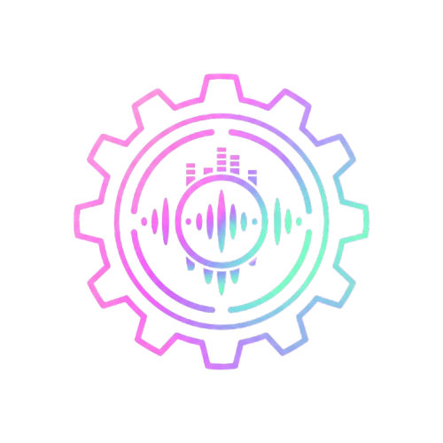

# 🎵 VS Code YouTube Background & Audio Visualizer

Una extensión para Visual Studio Code que transmite en tiempo real cualquier video y audio de YouTube que se esté reproduciendo en tu navegador, proyectándolo como fondo en el editor y generando un ecualizador reactivo en la terminal.

  

---

## ✨ Características

- 🎥 **Fondo en vivo sin pérdida de nitidez:** El video se reproduce detrás de tu código; el texto conserva el 100% de su brillo, color y legibilidad.
- 🔊 **Ecualizador simétrico en la terminal:** Barras de audio estilo retro/cyberpunk que se expanden desde el centro al ritmo de la música, recortando el video dentro de cada bloque.
- ⚡ **Explorer reactivo:** Los archivos que tienes abiertos en pestañas parpadean con resplandor neón en el color dominante del video y vibran sutilmente con cada golpe de bombo.
- 🌓 **Contraste dinámico y adaptativo:** Si el video entra en una escena oscura, los textos cambian automáticamente a blanco puro para no perder visibilidad.
- 🖱️ **Resaltado y cursor neón:** El cursor y la selección de texto (tanto en el editor como en la terminal) adoptan el color complementario del video con un borde definido de alto contraste.
- 🔄 **Segundo plano real y Autoplay:** El video no se congela si cambias de pestaña en tu navegador y avanza automáticamente a la siguiente canción en playlists.

---

## 📋 Requisitos

Antes de instalar, asegúrate de contar con lo siguiente:

1. **Visual Studio Code:** Versión `1.75.0` o superior.
2. **Extensión en VS Code:** [Custom CSS and JS Loader](https://marketplace.visualstudio.com/items?itemName=be5invis.vscode-custom-css) de *be5invis* (necesaria para inyectar scripts en la interfaz de Electron).
3. **Navegador web:** Chrome, Edge, Brave o Firefox.
4. **Extensión en el navegador:** [Tampermonkey](https://www.tampermonkey.net/) o [Violentmonkey]().

---

## 🚀 Instalación y Uso

### 1. Instalar la extensión en VS Code
1. Ve a la sección de **Releases** de este repositorio y descarga el archivo `.vsix` más reciente.
2. En VS Code, ve a la pestaña de extensiones (`Ctrl + Shift + X`).
3. Haz clic en el menú de tres puntos (`...`) arriba a la derecha y selecciona **"Install from VSIX..."**.
4. Selecciona el archivo descargado.

### 2. Instalar el Userscript en tu Navegador
1. Abre el panel de **Tampermonkey** en tu navegador.
2. Crea un nuevo script y pega el código que se encuentra en `browser-script.user.js` (o copia el script de transmisión de YouTube).
3. Guarda el script (`Ctrl + S`).

### 3. Activar los estilos
1. En VS Code, presiona `Ctrl + Shift + P`.
2. Escribe y ejecuta: `Reload Custom CSS and JS`.
3. Haz clic en **Restart**.

¡Listo! Abre cualquier video o playlist en YouTube y el editor se conectará automáticamente.

---

## 🛠️ Tecnologías utilizadas

- **WebRTC (MediaStream API):** Transmisión local de video y audio en tiempo real sin consumir ancho de banda extra.
- **Web Audio API:** Análisis espectral de frecuencias de sonido (FFT).
- **WebSockets:** Canal de señalización local para sincronización inmediata.
- **HTML5 Canvas:** Renderizado acelerado por hardware para el ecualizador y extracción de color cromático.

---

## 👤 Autor

Creado por [jhonr](https://github.com/Owochan2004).